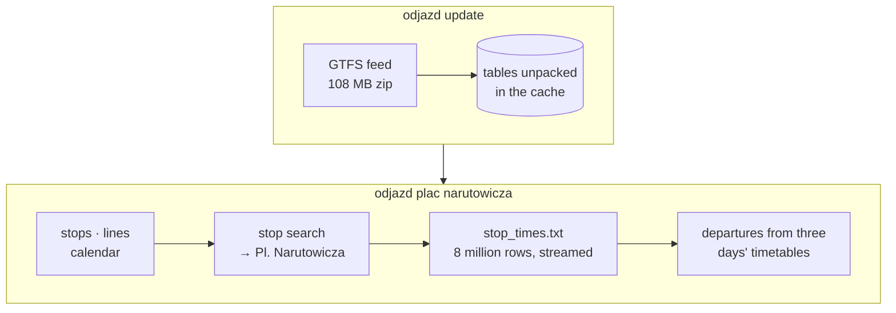

<p align="center">
  
</p>

<p align="center">
  <a href="https://github.com/bar2sh/odjazd/actions/workflows/ci.yml"></a>
  
  
  <a href="LICENSE"></a>
</p>

<p align="center">
  <b>Next departures from any Warsaw public transport stop, right in your terminal.</b><br>
  <sub><i>Odjazd</i> is Polish for “departure”.</sub>
</p>

<p align="center">
  
</p>

## Highlights

- **A live board.** Run `odjazd` on its own, type a stop's name and keep its departures
  on screen, counting down by the second and refreshing themselves.
- **Forgiving stop search.** `plac narutowicza`, `pl narutowicza` and `narutowica` all
  find *Pl. Narutowicza*; Polish letters are optional.
- **Whole stops, not single poles.** All poles of a stop are shown together, and a metro
  station is merged with the "Metro …" bus and tram stops above it.
- **Lines in their real colours**: red trams, purple buses, blue M1. The column after the
  direction is the pole number from the stop sign, and `~` marks metro times, which the
  timetable only gives as "every few minutes".
- **GTFS done right.** Night trips written as `24:05:00`, holiday timetables, metro
  headways, the 25-hour day when the clocks go back, and trips that end at the stop or
  only loop around it.
- **One small binary.** No runtime, no account, no API key.

## Install

You need a recent stable Rust ([rustup.rs](https://rustup.rs)).

```bash
cargo install --git https://github.com/bar2sh/odjazd odjazd
```

The first run downloads Warsaw's timetable (about 110 MB, 570 MB unpacked) into your
cache directory.

## Usage

```bash
odjazd                            # the live board: find a stop as you type
odjazd centrum --live             # the live board of one stop
odjazd "dworzec centralny"        # the next 12 departures, printed once
odjazd politechnika -n 5          # just 5 of them
odjazd centrum --at 23:50         # what still runs late tonight
odjazd stops narutowicza          # which stops match, with their poles
odjazd update                     # download a fresh timetable
odjazd update --url <gtfs.zip>    # ...or another city's GTFS feed
```

### The live board

<p align="center">
  
</p>

Type to search, pick a stop with the arrow keys and press Enter. Its departures stay on
screen, counting down by the second; the ones about to leave turn amber, and the board
asks the timetable again every 30 seconds. Tab moves on to the next matching stop, Esc
goes back to the search and `q` quits.

The animation is the app itself: its own drawing code, run on the real timetable at rush
hour on a test terminal, sped up in the second half.

### Where the timetable lives

The timetable lives in the system cache directory (`~/Library/Caches/odjazd` on macOS,
`~/.cache/odjazd` on Linux). Set `ODJAZD_DATA_DIR` to keep it somewhere else.

## How it works

odjazd reads Warsaw's timetable as [GTFS](https://gtfs.org), the format behind transit
directions in Google Maps: a zip of CSV tables.



A few details make this harder than it looks:

- **A service day is not a calendar day.** GTFS counts time from "noon minus 12 hours" of
  the day a timetable belongs to, so Friday's last night bus leaves at `24:05:00`. odjazd
  reads yesterday's, today's and tomorrow's timetables and turns every time into a real
  instant with [jiff](https://github.com/BurntSushi/jiff), which also gets the 25-hour
  day in October right.
- **The metro has no timetable**, only headways: "every 150 seconds between 05:50 and
  09:23" in `frequencies.txt`. odjazd expands them into estimated departures, marked `~`.
- **Arriving is not departing.** A trip is listed only if it goes on to somewhere else.
  A tram that ends here, or only loops round to another pole of the same stop, is not.
- **Speed.** Most of the 8 million rows belong to other days. Trips are looked up once
  per trip rather than once per row, so those rows are skipped after a single comparison.
  Trimming whitespace in every CSV field took two thirds of the run time, so only the
  fields in use are trimmed. A query takes about 0.75 s on an Apple M-series laptop.

The code is split into two crates:

| Crate | What it does |
|---|---|
| [`odjazd-core`](crates/odjazd-core) | GTFS parsing, stop search, departures. No networking or terminal I/O, so it can be compiled to WebAssembly. |
| [`odjazd`](crates/odjazd) | The command-line app: downloading, arguments, colours, and the live board. |

Built with [clap](https://crates.io/crates/clap), [csv](https://crates.io/crates/csv) +
[serde](https://serde.rs), [jiff](https://crates.io/crates/jiff),
[ratatui](https://ratatui.rs), [ureq](https://crates.io/crates/ureq),
[zip](https://crates.io/crates/zip) and [anstream](https://crates.io/crates/anstream).

## Development

```bash
cargo test --workspace
cargo clippy --workspace --all-targets -- -D warnings
cargo fmt --all
```

The tests run against a tiny hand-written feed in
[`crates/odjazd-core/tests/fixtures/mini`](crates/odjazd-core/tests/fixtures/mini) that
covers each tricky case above. Both animations come from real output, after `odjazd
update`:

```bash
cargo build --release && python3 docs/demo.py swietokrzyska
cargo test -p odjazd --release -- --ignored readme_animation   # docs/tui.svg
```

## Data

The timetable comes from [Zarząd Transportu Miejskiego w Warszawie](https://ztm.waw.pl),
converted to GTFS by [Mikołaj Kuranowski](https://mkuran.pl/gtfs/). odjazd downloads it
from there and does not redistribute it.

## License

[MIT](LICENSE)
