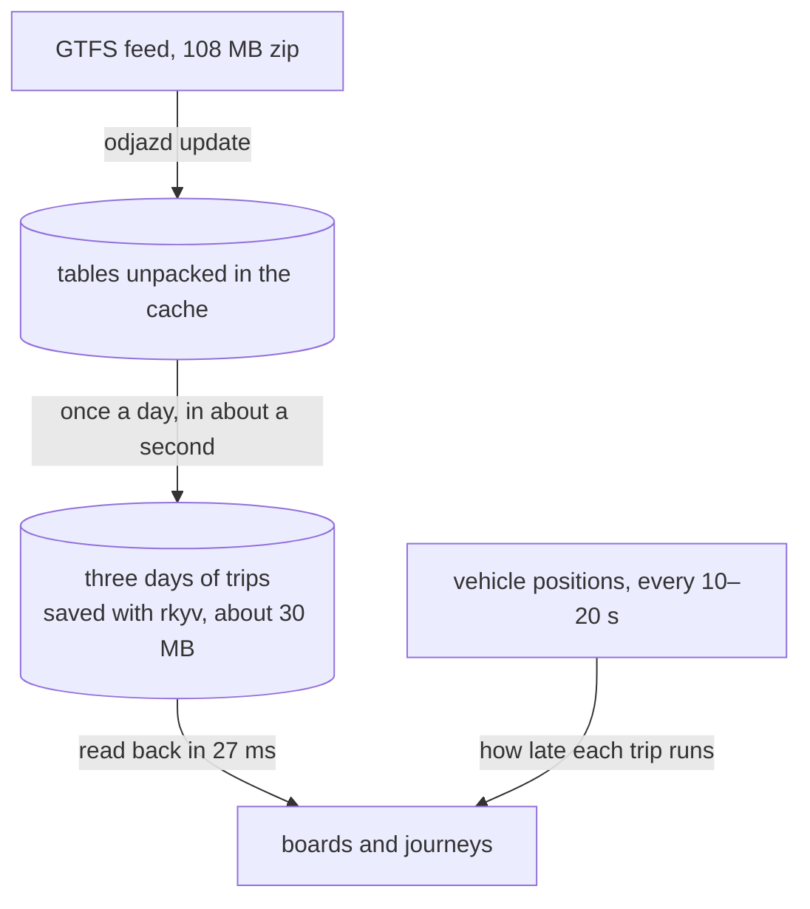
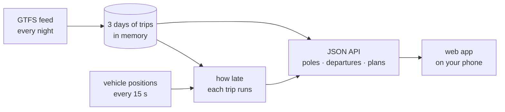

<p align="center">
  
</p>

<p align="center">
  <a href="https://github.com/bar2sh/odjazd/actions/workflows/ci.yml"></a>
  
  
  <a href="LICENSE"></a>
</p>

<p align="center">
  <b>Next departures from any Warsaw public transport stop, in your terminal or on your phone.</b><br>
  <sub><i>Odjazd</i> is Polish for “departure”.</sub>
</p>

<p align="center">
  
</p>

## Highlights

- **A live board.** Run `odjazd` on its own, type a stop's name and keep its departures
  on screen, counting down by the second to when each bus and tram will really come.
- **Forgiving stop search.** `plac narutowicza`, `pl narutowicza` and `narutowica` all
  find *Pl. Narutowicza*; Polish letters are optional.
- **Whole stops, not single poles.** All poles of a stop are shown together, and a metro
  station is merged with the "Metro …" bus and tram stops above it.
- **Lines in their real colours**: red trams, purple buses, blue M1. The column after the
  direction is the pole number from the stop sign, and `~` marks metro times, which the
  timetable only gives as "every few minutes".
- **GTFS done right.** Night trips written as `24:05:00`, holiday timetables, metro
  headways, the 25-hour day when the clocks go back, and trips that end at the stop or
  only loop around it.
- **Live delays.** The city publishes where every bus and tram is, but not how late it
  runs. odjazd works that out from each vehicle's GPS position, and leaves out a vehicle
  that has already passed your stop.
- **Which pole to walk to.** `odjazd route` plans a journey from every pole within walking
  distance, live delays included, and tells you where to go and when to leave. In the web
  app, set Home and Work and the plans are one tap away.
- **In the browser, too.** On the [map page](https://bar2sh.github.io/odjazd/), pick a
  pole and its departures come up, worked out in your browser by the same engine compiled
  to WebAssembly.
- **Quick.** A board, live delays included, is on screen in a tenth of a second: the
  timetable is worked out once a day and read back in milliseconds.
- **One small binary.** No runtime, no account, no API key.

## Install

Download the archive for your system from the
[latest release](https://github.com/bar2sh/odjazd/releases/latest): macOS (Apple silicon
or Intel), Linux or Windows. Unpack it and put `odjazd` on your `PATH`. macOS may block
the unsigned binary at first; `xattr -d com.apple.quarantine odjazd` clears that.

Or build it with a recent stable Rust ([rustup.rs](https://rustup.rs)):

```bash
cargo install --git https://github.com/bar2sh/odjazd odjazd
```

The first run downloads Warsaw's timetable (about 110 MB, 570 MB unpacked) into your
cache directory.

## Usage

```bash
odjazd                            # the live board: find a stop as you type
odjazd centrum --watch            # the live board of one stop
odjazd "dworzec centralny"        # the next 12 departures, printed once
odjazd politechnika -n 5          # just 5 of them
odjazd centrum --at 23:50         # what still runs late tonight, by the timetable
odjazd centrum --offline          # the timetable alone, without live delays
odjazd route centrum wilenski     # the quickest ways from one stop to another
odjazd stops narutowicza          # which stops match, with their poles
odjazd update                     # download a fresh timetable
odjazd update --url <gtfs.zip>    # ...or another city's GTFS feed
```

### The live board

<p align="center">
  
</p>

Type to search, pick a stop with the arrow keys and press Enter. Its departures stay on
screen, counting down by the second. Every 15 seconds the board finds out where the buses
and trams are, and shows how late each one runs (`+2`, or a green `●` when on time) and
how many stops away it is; the ones about to leave turn amber. `r` asks for the vehicles
at once, Tab moves on to the next matching stop, Esc goes back to the search and `q`
quits.

The animation is the app itself: its own drawing code, run on the real timetable and
three minutes of real vehicle positions on a test terminal, sped up in the second half.

### Journeys

```console
$ odjazd route "plac narutowicza" "dworzec wilenski" --at 8:15
Pl. Narutowicza → Dw. Wileński  Fri 30 Oct, 08:15

08:17 → 08:43  26 min, 1 change
  08:17  walk to Pl. Narutowicza 07
  08:18   1    Żerań Wschodni  3 stops to Rondo Daszyńskiego 06, 08:25
  08:25  walk 3 min to Rondo Daszyńskiego
  08:31   M2   Bródno          6 stops to Dworzec Wileński, 08:43

08:17 → 08:45  28 min, no changes
  08:17  walk to Pl. Narutowicza 12
  08:18   25   Annopol         14 stops to Dw. Wileński 08, 08:45
```

Each way starts at a different pole, so the first line says which one to walk to. Without
`--at`, the times count live delays in: a late tram can make the bus across the street the
better choice. Ways are listed soonest there first, and each one is worth a look: compared
with any way above it, it has fewer changes, or lets you set off at least five minutes later
and takes no longer.

### Where the timetable lives

The timetable lives in the system cache directory (`~/Library/Caches/odjazd` on macOS,
`~/.cache/odjazd` on Linux): the feed as downloaded, and today's timetable worked out
from it, saved in binary form. Working it out takes about a second, once a day or right
after `odjazd update`; reading it back takes milliseconds. Set `ODJAZD_DATA_DIR` to keep
it all somewhere else.

## In the browser

[bar2sh.github.io/odjazd](https://bar2sh.github.io/odjazd/) is odjazd with nothing to
install. Search for a stop, or pick a pole on the map, and its next departures come up on
the amber board. No server works them out: `odjazd-core` runs in your browser, compiled
to WebAssembly, on a timetable that GitHub Actions builds every night. Yesterday, today
and tomorrow come in one file of 2–3.5 MB, saved in binary form with
[rkyv](https://rkyv.org), which a laptop loads in under half a second. The page goes by
the timetable alone; for live delays, use the command line or the web app.

## Web app

`odjazd-web` puts the same engine on your phone. It finds the poles nearest to you, each
on its own (Świętokrzyska 01, 02, 03…), shows what leaves from each with live delays,
and, once you have set Home or Work, tells you which pole to walk to and when to leave.
It installs as an app (PWA).

```bash
cargo run --release -p odjazd-web     # then open http://localhost:8080
```

The server downloads the timetable on its first start, or reuses the one `odjazd update`
fetched, and refreshes it every night. Browsers share your location only with pages
served over HTTPS (or from localhost), so to use it on a phone, host it behind HTTPS: the
[Dockerfile](Dockerfile) builds a small container that runs anywhere. The JSON API is
described in [`crates/odjazd-web/API.md`](crates/odjazd-web/API.md).

The map shows OpenStreetMap's own tiles, which is fine for trying it out. Their
[tile usage policy](https://operations.osmfoundation.org/policies/tiles/) is not meant
for an app many people use, so before putting it online, point `TILES` in
[`web/map.js`](crates/odjazd-web/web/map.js) at a tile provider of your own.

## How it works

odjazd reads Warsaw's timetable as [GTFS](https://gtfs.org), the format behind transit
directions in Google Maps: a zip of CSV tables. Once a day it works out three days of
trips from them, laid out for quick answers, and saves that; every board and journey
starts from the saved copy.



The web app keeps the same timetable in memory, and follows the vehicles as they go:



A few details make this harder than it looks:

- **A service day is not a calendar day.** GTFS counts time from "noon minus 12 hours" of
  the day a timetable belongs to, so Friday's last night bus leaves at `24:05:00`. odjazd
  reads yesterday's, today's and tomorrow's timetables and turns every time into a real
  instant with [jiff](https://github.com/BurntSushi/jiff), which also gets the 25-hour
  day in October right.
- **The metro has no timetable**, only headways: "every 150 seconds between 05:50 and
  09:23" in `frequencies.txt`. odjazd expands them into estimated departures, marked `~`.
- **Arriving is not departing.** A trip is listed only if it goes on to somewhere else.
  A tram that ends here, or only loops round to another pole of the same stop, is not.
- **Live delays come from positions.** Warsaw publishes every vehicle's GPS position
  every 10–20 seconds ([GTFS-Realtime](https://gtfs.org/documentation/realtime/)), but no
  delays. odjazd finds where along its trip each vehicle is, between which two stops and
  how far, compares that with when the timetable says it should be there, and carries the
  difference over to the stops ahead. A tram waiting at a stop ahead of time is not early;
  one that has passed your stop is gone, whatever the timetable says.
- **Which pole to walk to** is a journey-planning question. The trips are laid out for
  [RAPTOR](https://www.microsoft.com/en-us/research/publication/round-based-public-transit-routing/)
  (Delling, Pajor, Werneck), which odjazd runs from every pole within walking distance,
  with live delays: a late tram can make the bus across the street the better choice.
- **Most of `stop_times.txt` is for other days.** Of its 8 million rows, odjazd looks
  each trip up once rather than once per row, so the rest are skipped after a single
  comparison. Trimming whitespace in every CSV field took two thirds of the time, so only
  the fields in use are trimmed. Then [rkyv](https://rkyv.org) saves the result in binary
  form, which is checked and read back in milliseconds instead.

### How fast

On an Apple M-series laptop, with Warsaw's timetable for 8:15 on a Monday:

| | |
|---|---|
| Open the feed: stops, lines and calendar | 6.6 ms |
| Work out three days of trips | 1.1 s |
| Read them back from the saved copy | 27 ms |
| Find a stop by name, among 2,883 | 0.27 ms |
| A board: the next 12 departures from Centrum's 10 poles | 0.10 ms |
| A journey: Pl. Narutowicza → Dw. Wileński, from the 40 nearest poles | 84 ms |
| Where 1,596 buses and trams are along their trips, and how late | 1.1 ms |

`cargo bench -p odjazd-core --features cache` measures these with
[criterion](https://crates.io/crates/criterion), on the timetable `odjazd update`
downloaded. The vehicles are put where the timetable says they are, so the numbers do not
depend on when it runs.

The code is split into four crates, the map page and the task that builds it:

| Part | What it does |
|---|---|
| [`odjazd-core`](crates/odjazd-core) | GTFS and GTFS-Realtime parsing, stop search, departures, live delays, journey planning, and the timetable in binary form. No networking or terminal I/O, so it can be compiled to WebAssembly. |
| [`odjazd`](crates/odjazd) | The command-line app: downloading, arguments, colours, journeys and the live board. |
| [`odjazd-web`](crates/odjazd-web) | The web app and its JSON API: keeps the timetable fresh, follows vehicle positions, serves the PWA. |
| [`odjazd-wasm`](crates/odjazd-wasm) | odjazd-core for the browser, through wasm-bindgen: stop search, boards and every pole for the map, from the timetable in binary form. |
| [`site`](site) | The map page: HTML, CSS and JavaScript around odjazd-wasm, with a MapLibre map. |
| [`xtask`](xtask) | `cargo xtask site`, which builds the map page and the timetable it loads. |

Built with [clap](https://crates.io/crates/clap), [csv](https://crates.io/crates/csv) +
[serde](https://serde.rs), [jiff](https://crates.io/crates/jiff), [rkyv](https://rkyv.org),
[ratatui](https://ratatui.rs), [ureq](https://crates.io/crates/ureq),
[zip](https://crates.io/crates/zip), [anstream](https://crates.io/crates/anstream) and
[prost](https://crates.io/crates/prost); the web app with [axum](https://crates.io/crates/axum)
on [tokio](https://tokio.rs), and [Leaflet](https://leafletjs.com) for its map; the map page with
[wasm-bindgen](https://crates.io/crates/wasm-bindgen) and [MapLibre GL JS](https://maplibre.org).

## Development

```bash
cargo test --workspace
cargo clippy --workspace --all-targets -- -D warnings
cargo fmt --all
```

The tests run against tiny hand-written feeds:
[`mini`](crates/odjazd-core/tests/fixtures/mini) covers each tricky case above, and
[`commute`](crates/odjazd-core/tests/fixtures/commute) a trip to work where a late tram
changes which pole to walk to. Both animations come from real output, after `odjazd
update` and at a busy hour, since they show where the vehicles are:

```bash
cargo build --release && python3 docs/demo.py swietokrzyska
cargo test -p odjazd --release -- --ignored readme_animation   # docs/tui.svg, 3 minutes
cargo bench -p odjazd-core --features cache                     # the table above, 2 minutes
```

The map page builds with `cargo xtask site` into `target/site`, from the feed `odjazd
update` downloaded or from `--feed` (a directory or a zip). It needs the WebAssembly
target and the wasm-bindgen CLI of the version in `Cargo.lock`, and says how to install
whichever is missing:

```bash
rustup target add wasm32-unknown-unknown
cargo xtask site                          # about 30 s, most of it compressing the timetable
python3 -m http.server -d target/site     # then open http://localhost:8000
```

## Data

The timetable comes from [Zarząd Transportu Miejskiego w Warszawie](https://ztm.waw.pl),
converted to GTFS by [Mikołaj Kuranowski](https://mkuran.pl/gtfs/). Vehicle positions come
from [Miasto Stołeczne Warszawa](http://api.um.warszawa.pl), matched to the timetable by
Mikołaj Kuranowski. odjazd downloads both from there. The map page publishes a processed
copy of three days of the timetable, as the
[ZTM terms](https://www.ztm.waw.pl/pliki-do-pobrania/dane-rozkladowe/) allow: it names its
sources and is rebuilt every night, so that it stays current. The maps are ©
[OpenStreetMap](https://www.openstreetmap.org/copyright) contributors, and the map page's
tiles come from [OpenFreeMap](https://openfreemap.org).

## License

[MIT](LICENSE)
