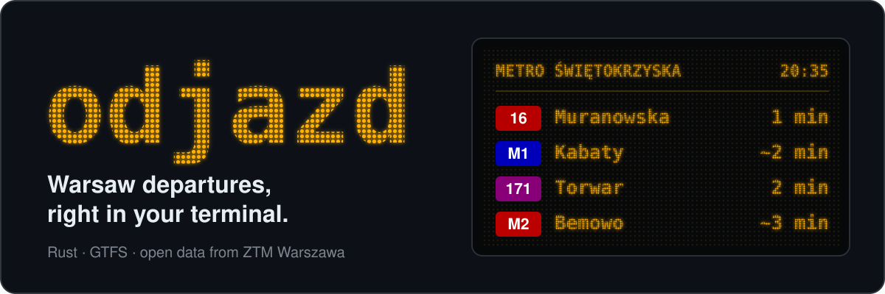
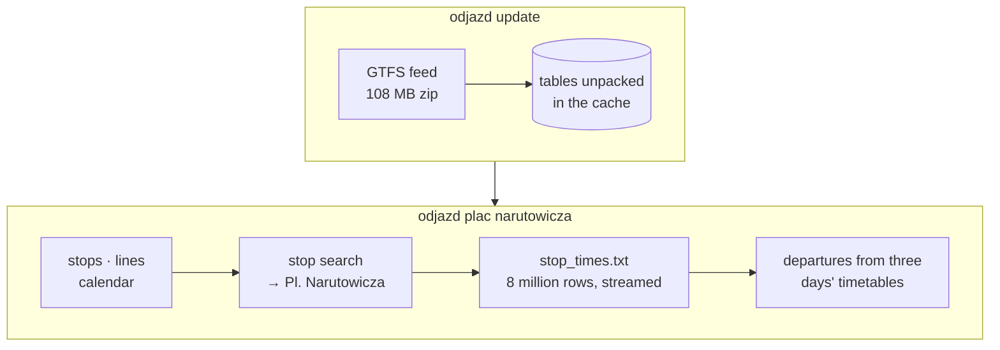
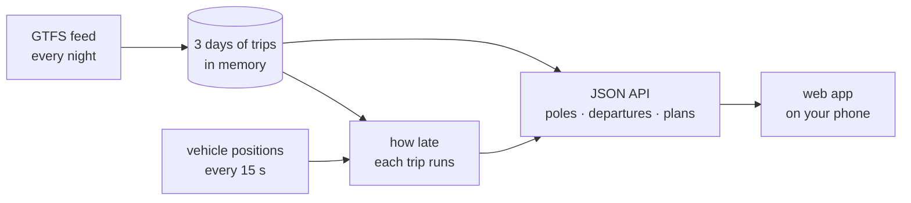

<p align="center">
  
</p>

<p align="center">
  <a href="https://github.com/bar2sh/odjazd/actions/workflows/ci.yml"></a>
  
  
  <a href="LICENSE"></a>
</p>

<p align="center">
  <b>Next departures from any Warsaw public transport stop, in your terminal or on your phone.</b><br>
  <sub><i>Odjazd</i> is Polish for “departure”.</sub>
</p>

<p align="center">
  
</p>

## Highlights

- **A live board.** Run `odjazd` on its own, type a stop's name and keep its departures
  on screen, counting down by the second to when each bus and tram will really come.
- **Forgiving stop search.** `plac narutowicza`, `pl narutowicza` and `narutowica` all
  find *Pl. Narutowicza*; Polish letters are optional.
- **Whole stops, not single poles.** All poles of a stop are shown together, and a metro
  station is merged with the "Metro …" bus and tram stops above it.
- **Lines in their real colours**: red trams, purple buses, blue M1. The column after the
  direction is the pole number from the stop sign, and `~` marks metro times, which the
  timetable only gives as "every few minutes".
- **GTFS done right.** Night trips written as `24:05:00`, holiday timetables, metro
  headways, the 25-hour day when the clocks go back, and trips that end at the stop or
  only loop around it.
- **Live delays.** The city publishes where every bus and tram is, but not how late it
  runs. odjazd works that out from each vehicle's GPS position, and leaves out a vehicle
  that has already passed your stop.
- **Which pole to walk to.** `odjazd route` plans a journey from every pole within walking
  distance, live delays included, and tells you where to go and when to leave. In the web
  app, set Home and Work and the plans are one tap away.
- **One small binary.** No runtime, no account, no API key.

## Install

You need a recent stable Rust ([rustup.rs](https://rustup.rs)).

```bash
cargo install --git https://github.com/bar2sh/odjazd odjazd
```

The first run downloads Warsaw's timetable (about 110 MB, 570 MB unpacked) into your
cache directory.

## Usage

```bash
odjazd                            # the live board: find a stop as you type
odjazd centrum --watch            # the live board of one stop
odjazd "dworzec centralny"        # the next 12 departures, printed once
odjazd politechnika -n 5          # just 5 of them
odjazd centrum --at 23:50         # what still runs late tonight, by the timetable
odjazd centrum --offline          # the timetable alone, without live delays
odjazd route centrum wilenski     # the quickest ways from one stop to another
odjazd stops narutowicza          # which stops match, with their poles
odjazd update                     # download a fresh timetable
odjazd update --url <gtfs.zip>    # ...or another city's GTFS feed
```

### The live board

<p align="center">
  
</p>

Type to search, pick a stop with the arrow keys and press Enter. Its departures stay on
screen, counting down by the second. Every 15 seconds the board finds out where the buses
and trams are, and shows how late each one runs (`+2`, or a green `●` when on time) and
how many stops away it is; the ones about to leave turn amber. `r` asks for the vehicles
at once, Tab moves on to the next matching stop, Esc goes back to the search and `q`
quits.

The animation is the app itself: its own drawing code, run on the real timetable and
three minutes of real vehicle positions on a test terminal, sped up in the second half.

### Journeys

```console
$ odjazd route "plac narutowicza" "dworzec wilenski" --at 8:15
Pl. Narutowicza → Dw. Wileński  Fri 30 Oct, 08:15

08:17 → 08:43  26 min, 1 change
  08:17  walk to Pl. Narutowicza 07
  08:18   1    Żerań Wschodni  3 stops to Rondo Daszyńskiego 06, 08:25
  08:25  walk 3 min to Rondo Daszyńskiego
  08:31   M2   Bródno          6 stops to Dworzec Wileński, 08:43

08:17 → 08:45  28 min, no changes
  08:17  walk to Pl. Narutowicza 12
  08:18   25   Annopol         14 stops to Dw. Wileński 08, 08:45
```

Each way starts at a different pole, so the first line says which one to walk to. Without
`--at`, the times count live delays in: a late tram can make the bus across the street the
better choice. Ways that would set off no later yet get there later, with no fewer
changes, are left out.

### Where the timetable lives

The timetable lives in the system cache directory (`~/Library/Caches/odjazd` on macOS,
`~/.cache/odjazd` on Linux). Set `ODJAZD_DATA_DIR` to keep it somewhere else.

## Web app

`odjazd-web` puts the same engine on your phone. It finds the poles nearest to you, each
on its own (Świętokrzyska 01, 02, 03…), shows what leaves from each with live delays,
and, once you have set Home or Work, tells you which pole to walk to and when to leave.
It installs as an app (PWA).

```bash
cargo run --release -p odjazd-web     # then open http://localhost:8080
```

The server downloads the timetable on its first start, or reuses the one `odjazd update`
fetched, and refreshes it every night. Browsers share your location only with pages
served over HTTPS (or from localhost), so to use it on a phone, host it behind HTTPS: the
[Dockerfile](Dockerfile) builds a small container that runs anywhere. The JSON API is
described in [`crates/odjazd-web/API.md`](crates/odjazd-web/API.md).

The map shows OpenStreetMap's own tiles, which is fine for trying it out. Their
[tile usage policy](https://operations.osmfoundation.org/policies/tiles/) is not meant
for an app many people use, so before putting it online, point `TILES` in
[`web/map.js`](crates/odjazd-web/web/map.js) at a tile provider of your own.

## How it works

odjazd reads Warsaw's timetable as [GTFS](https://gtfs.org), the format behind transit
directions in Google Maps: a zip of CSV tables.



The web app keeps the timetable in memory instead, and follows the vehicles as they go:



A few details make this harder than it looks:

- **A service day is not a calendar day.** GTFS counts time from "noon minus 12 hours" of
  the day a timetable belongs to, so Friday's last night bus leaves at `24:05:00`. odjazd
  reads yesterday's, today's and tomorrow's timetables and turns every time into a real
  instant with [jiff](https://github.com/BurntSushi/jiff), which also gets the 25-hour
  day in October right.
- **The metro has no timetable**, only headways: "every 150 seconds between 05:50 and
  09:23" in `frequencies.txt`. odjazd expands them into estimated departures, marked `~`.
- **Arriving is not departing.** A trip is listed only if it goes on to somewhere else.
  A tram that ends here, or only loops round to another pole of the same stop, is not.
- **Live delays come from positions.** Warsaw publishes every vehicle's GPS position
  every 10–20 seconds ([GTFS-Realtime](https://gtfs.org/documentation/realtime/)), but no
  delays. odjazd finds where along its trip each vehicle is, between which two stops and
  how far, compares that with when the timetable says it should be there, and carries the
  difference over to the stops ahead. A tram waiting at a stop ahead of time is not early;
  one that has passed your stop is gone, whatever the timetable says.
- **Which pole to walk to** is a journey-planning question. The web app keeps three days
  of the timetable in memory, laid out for [RAPTOR](https://www.microsoft.com/en-us/research/publication/round-based-public-transit-routing/)
  (Delling, Pajor, Werneck), and runs it from every pole within walking distance, with
  live delays: a late tram can make the bus across the street the better choice.
- **Speed.** Most of the 8 million rows belong to other days. Trips are looked up once
  per trip rather than once per row, so those rows are skipped after a single comparison.
  Trimming whitespace in every CSV field took two thirds of the run time, so only the
  fields in use are trimmed. A board takes about a second on an Apple M-series laptop,
  while the vehicle positions download alongside.

The code is split into three crates:

| Crate | What it does |
|---|---|
| [`odjazd-core`](crates/odjazd-core) | GTFS and GTFS-Realtime parsing, stop search, departures, live delays, journey planning. No networking or terminal I/O, so it can be compiled to WebAssembly. |
| [`odjazd`](crates/odjazd) | The command-line app: downloading, arguments, colours, journeys and the live board. |
| [`odjazd-web`](crates/odjazd-web) | The web app and its JSON API: keeps the timetable fresh, follows vehicle positions, serves the PWA. |

Built with [clap](https://crates.io/crates/clap), [csv](https://crates.io/crates/csv) +
[serde](https://serde.rs), [jiff](https://crates.io/crates/jiff),
[ratatui](https://ratatui.rs), [ureq](https://crates.io/crates/ureq),
[zip](https://crates.io/crates/zip), [anstream](https://crates.io/crates/anstream) and
[prost](https://crates.io/crates/prost); the web app with [axum](https://crates.io/crates/axum)
on [tokio](https://tokio.rs), and [Leaflet](https://leafletjs.com) for the map.

## Development

```bash
cargo test --workspace
cargo clippy --workspace --all-targets -- -D warnings
cargo fmt --all
```

The tests run against tiny hand-written feeds:
[`mini`](crates/odjazd-core/tests/fixtures/mini) covers each tricky case above, and
[`commute`](crates/odjazd-core/tests/fixtures/commute) a trip to work where a late tram
changes which pole to walk to. Both animations come from real output, after `odjazd
update` and at a busy hour, since they show where the vehicles are:

```bash
cargo build --release && python3 docs/demo.py swietokrzyska
cargo test -p odjazd --release -- --ignored readme_animation   # docs/tui.svg, 3 minutes
```

## Data

The timetable comes from [Zarząd Transportu Miejskiego w Warszawie](https://ztm.waw.pl),
converted to GTFS by [Mikołaj Kuranowski](https://mkuran.pl/gtfs/). Vehicle positions come
from [Miasto Stołeczne Warszawa](http://api.um.warszawa.pl), matched to the timetable by
Mikołaj Kuranowski. odjazd downloads both from there and does not redistribute them. The
web app's map is © [OpenStreetMap](https://www.openstreetmap.org/copyright) contributors.

## License

[MIT](LICENSE)
